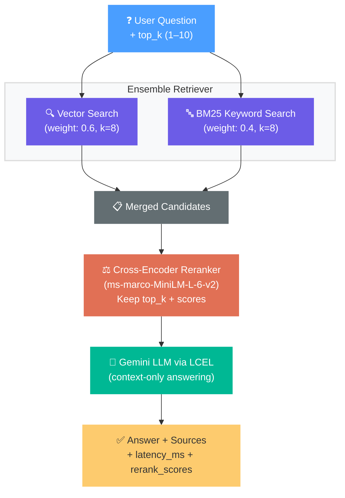

# 📄 RAG Document QA


A **production-grade Retrieval-Augmented Generation** API that lets you upload documents (PDF/TXT), automatically chunks and embeds them into a vector store, and then answers natural-language questions grounded strictly in the uploaded content. The system combines semantic search with keyword matching via a hybrid retriever, reranks candidates using a cross-encoder model, and generates answers with Google's Gemini LLM — ensuring responses are always traceable back to source documents and never hallucinated from outside knowledge.

**Production features:** non-blocking async I/O via thread pool offloading, Pydantic v2 input validation with whitespace stripping, file path sanitization with size limits, singleton resource management, structured logging, configurable `top_k` retrieval, per-query latency tracking, cross-encoder rerank scores in API responses, and a deterministic LCEL pipeline replacing the deprecated `RetrievalQAWithSourcesChain`.

---

## Architecture

The system runs two pipelines through a single FastAPI server:

### Ingestion Pipeline — `POST /ingest`

```mermaid
flowchart LR
    A["📄 Upload PDF/TXT\n(≤ 20 MB)"] --> V["🛡️ Validate\n(sanitize path, check ext)"]
    V --> B["📖 Document Loader\n(PyPDF / TextLoader)"]
    B --> C["✂️ Text Splitter\n(800 chars, 150 overlap)"]
    C --> CHK["✅ Non-empty\nchunk check"]
    CHK --> D["🧠 Gemini Embeddings\n(singleton instance)"]
    D --> E[("💾 ChromaDB\n(persisted to disk)")]

    style A fill:#4a9eff,color:#fff,stroke:none
    style V fill:#e17055,color:#fff,stroke:none
    style B fill:#6c5ce7,color:#fff,stroke:none
    style C fill:#6c5ce7,color:#fff,stroke:none
    style CHK fill:#e17055,color:#fff,stroke:none
    style D fill:#00b894,color:#fff,stroke:none
    style E fill:#fdcb6e,color:#333,stroke:none
```



### Retrieval Pipeline — `POST /query`



---

## Quickstart (Docker — Recommended)

The fastest and most consistent way to run the service is with Docker Compose. The container is configured with CPU-only PyTorch and pre-caches the CrossEncoder model at build time for instantaneous startup.

```bash
# 1. Clone the repository
git clone https://github.com/abhay-ugale-25/RagDocQA.git
cd RagDocQA

# 2. Configure your environment
cp .env.example .env    # On Windows: copy .env.example .env
# Edit .env and set your GOOGLE_API_KEY

# 3. Build and launch the container
docker compose up --build -d
```

The API will be available at `http://127.0.0.1:8000` with interactive Swagger UI docs at `http://127.0.0.1:8000/docs`.

<details>
<summary><b>Alternative: Local Virtual Environment Setup</b></summary>

### Prerequisites

- Python 3.10+
- A [Google AI API key](https://aistudio.google.com/apikey)

### Installation

```bash
# Clone the repository
git clone https://github.com/abhay-ugale-25/RagDocQA.git
cd RagDocQA

# Create and activate a virtual environment
python -m venv venv
venv\Scripts\activate        # Windows
# source venv/bin/activate   # macOS / Linux

# Install dependencies
pip install -r requirements.txt

# Configure your API key
copy .env.example .env       # Windows
# cp .env.example .env       # macOS / Linux
# Then edit .env and paste your GOOGLE_API_KEY
```

### Run the Server

```bash
uvicorn app.main:app --reload --port 8000
```

</details>

---

## API Reference

### `GET /health` — Health Check

```bash
curl http://127.0.0.1:8000/health
```

**Response** `200 OK`
```json
{
  "status": "ok"
}
```

---

### `POST /ingest` — Upload & Ingest a Document

```bash
curl -X POST http://127.0.0.1:8000/ingest \
  -F "file=@./data/my_paper.pdf"
```

**Response** `200 OK`
```json
{
  "status": "ingested",
  "file": "my_paper.pdf",
  "chunks": 66
}
```

| Parameter | Type         | Description                                        |
|-----------|--------------|----------------------------------------------------|
| `file`    | `UploadFile` | PDF or TXT file to ingest (max 20 MB)              |

**Validation & Error Handling:**
- Filenames are sanitized via `os.path.basename()` to prevent path traversal.
- Files exceeding **20 MB** are rejected with `400 Bad Request`.
- Unsupported file extensions (anything other than `.pdf` / `.txt`) return `400`.
- Documents producing **zero text chunks** return `400` with `"No extractable text found in document."`

---

### `POST /query` — Ask a Question

```bash
curl -X POST http://127.0.0.1:8000/query \
  -H "Content-Type: application/json" \
  -d '{"question": "What is the main contribution of this paper?", "top_k": 4}'
```

**Request Body**

| Field      | Type     | Required | Description                                                     |
|------------|----------|----------|-----------------------------------------------------------------|
| `question` | `string` | ✅       | Natural-language question (3–2000 chars, whitespace auto-stripped) |
| `top_k`    | `int`    | ❌       | Number of reranked chunks to use (1–10, default: 4)             |

**Response** `200 OK`
```json
{
  "answer": "The main contribution of this paper is the introduction of the Transformer...",
  "sources": ["my_paper.pdf"],
  "reranked": true,
  "latency_ms": 1523.47,
  "rerank_scores": [0.9987, 0.9412, 0.8876, 0.7103]
}
```

| Field           | Type           | Description                                              |
|-----------------|----------------|----------------------------------------------------------|
| `answer`        | `string`       | LLM-generated answer grounded in the uploaded documents  |
| `sources`       | `list[str]`    | Source filenames the answer was derived from              |
| `reranked`      | `bool\|null`   | Whether cross-encoder reranking was applied              |
| `latency_ms`    | `float`        | End-to-end query latency in milliseconds                 |
| `rerank_scores` | `list[float]`  | Cross-encoder relevance scores for each returned chunk   |

---

## Tech Stack

| Component             | Library                          | Why                                                                 |
|-----------------------|----------------------------------|---------------------------------------------------------------------|
| **Web Framework**     | FastAPI                          | Async-first, auto-generated OpenAPI docs, Pydantic v2 validation    |
| **ASGI Server**       | Uvicorn                          | Lightning-fast ASGI server, hot-reload for development              |
| **LLM**              | Gemini 3.1 Flash Lite            | Fast, low-latency responses; generous free-tier quota               |
| **Embeddings**        | Gemini Embedding 001             | High-quality dense embeddings optimized for retrieval               |
| **Vector Store**      | ChromaDB                         | Simple, file-persisted vector DB — zero infrastructure overhead     |
| **Orchestration**     | LangChain Core (LCEL)            | Deterministic `RunnableLambda` pipeline; no deprecated chain classes|
| **PDF Parsing**       | PyPDF                            | Reliable text extraction from PDF documents                         |
| **Keyword Search**    | rank-bm25                        | Classic TF-IDF style retriever for exact keyword matching            |
| **Reranker**          | sentence-transformers (CrossEncoder) | `ms-marco-MiniLM-L-6-v2` scores query-document relevance precisely |
| **Validation**        | Pydantic v2                      | Type-safe models with `Field` constraints, validators, and `ConfigDict` |
| **Async I/O**         | `run_in_threadpool`              | Offloads blocking calls to thread pool; keeps the event loop free   |
| **Logging**           | Python `logging`                 | Structured, leveled logging replacing `print()` statements          |
| **Config**            | python-dotenv                    | Loads API keys from `.env` — keeps secrets out of code              |

---

## Architectural Trade-offs & Production Specs

### 1. Why Hybrid Retrieval (Dense + BM25) + Cross-Encoder?

Production RAG systems suffer from two primary failure modes: semantic drift from dense vector search (which can retrieve text that sounds conceptually related but lacks exact term matches) and lexical blindness from keyword search (which fails when users paraphrase). 

To solve this, the pipeline decouples retrieval into two distinct stages:

* **Stage 1: Recall Optimization (Ensemble Retriever):**
  Uses `EnsembleRetriever` to query ChromaDB (`k=8`, weight `0.6`) and an in-memory BM25 index (`k=8`, weight `0.4`). Dense embeddings (`models/gemini-embedding-001`) capture high-level semantic intent, while sparse BM25 scores exact keyword hits (such as model acronyms, function names, and technical identifiers). Candidates are merged using Reciprocal Rank Fusion (RRF), yielding 12–16 unique candidate chunks and maximizing overall recall.

* **Stage 2: Precision Optimization (Cross-Encoder Reranker):**
  Bi-encoder embeddings project queries and documents into vector space independently, missing fine-grained token-to-token interactions. To eliminate false positives, candidates are reranked using `cross-encoder/ms-marco-MiniLM-L-6-v2`. The Cross-Encoder performs joint token-level cross-attention across the combined `(query, chunk)` input sequence, computing an unbounded logit that is mapped via a sigmoid transformation (`1 / (1 + exp(-score))`) to a normalized `[0.0, 1.0]` probability score. Only the top `top_k` chunks (default `4`) are forwarded to the LLM.

### 2. Chunking Granularity (800 chars / 150 overlap)

The chunking configuration balances semantic completeness against model context windows:

* **Hard Token Constraints:** `ms-marco-MiniLM-L-6-v2` enforces a hard maximum sequence length of **512 tokens**. A naive 1,500+ character chunk paired with a user query would silently truncate tail tokens during reranking, leading to missed evidence.
* **Token Budget Safety:** 800 characters translates to approximately **180–220 tokens** in standard English text. When concatenated as `[CLS] query [SEP] chunk [SEP]`, the input sequence stays well beneath the 512-token ceiling, guaranteeing complete bidirectional attention over every chunk word.
* **150-Character Sliding Window:** Overlapping adjacent chunks by 150 characters prevents boundary fragmentation—ensuring sentences, equations, or definitions that span chunk splits retain sufficient surrounding context for both embedding models and LLM reasoning.

### 3. Event Loop Concurrency & Latency Profile

FastAPI route handlers are declared as `async def`. However, heavy machine learning inference and document processing tasks are inherently CPU-bound and synchronous:
* **PyPDF extraction** and disk file I/O
* **BM25 tokenization and lexical inverted index building**
* **PyTorch CrossEncoder matrix multiplications**

Executing these operations directly inside `async def` functions blocks Python's single-threaded asyncio event loop, causing incoming HTTP requests to queue and stalling overall server throughput. To preserve high concurrency, all blocking stages (`load_documents`, `build_vectorstore`, `build_qa_chain`, and `qa_chain.invoke`) are dispatched to worker threads using `fastapi.concurrency.run_in_threadpool`.

#### Typical Latency Breakdown (CPU Execution)

| Pipeline Stage | Implementation Detail | Typical Latency (CPU) |
|----------------|-----------------------|-----------------------|
| **Hybrid Retrieval** | Chroma dense search (`k=8`) + BM25 lexical scan (`k=8`) | `~80 – 140 ms` (I/O + In-Memory Lexical Scan) |
| **Cross-Encoder Reranking** | `ms-marco-MiniLM-L-6-v2` scoring 12–16 candidate pairs | `~180 – 320 ms` (CPU-bound PyTorch Inference) |
| **LLM Generation** | `gemini-3.1-flash-lite` context synthesis via LCEL | `~650 – 1,100 ms` (External Network API) |
| **End-to-End `/query` Total** | Full ingestion-to-answer latency | **`~950 – 1,550 ms`** |

---

## Project Structure

```
RagDocQA/
├── app/
│   ├── __init__.py      ← Application package initializer
│   ├── main.py          ← FastAPI routes, lifespan management, async threadpool execution
│   ├── ingest.py        ← Path sanitization, PDF/TXT loaders, singleton embeddings, chunk validation
│   ├── retriever.py     ← Hybrid ensemble, CrossEncoder reranking (sigmoid normalized), LCEL pipeline
│   └── schemas.py       ← Pydantic v2 request/response schemas with field validation
├── data/                ← Uploaded source documents (persisted via Docker bind mount)
├── vectorstore/         ← ChromaDB SQLite storage & indices (persisted via Docker bind mount)
├── Dockerfile           ← Lightweight container build with CPU-only PyTorch & pre-cached model
├── docker-compose.yml   ← Container orchestration with volume mounts & .env injection
├── .env.example         ← Environment template for API keys
├── .gitignore           ← Git ignore patterns (ignores local data, vectors, caches)
├── requirements.txt     ← Application dependencies
└── README.md            ← System architecture, API reference, and production specs
```

