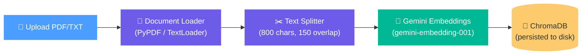
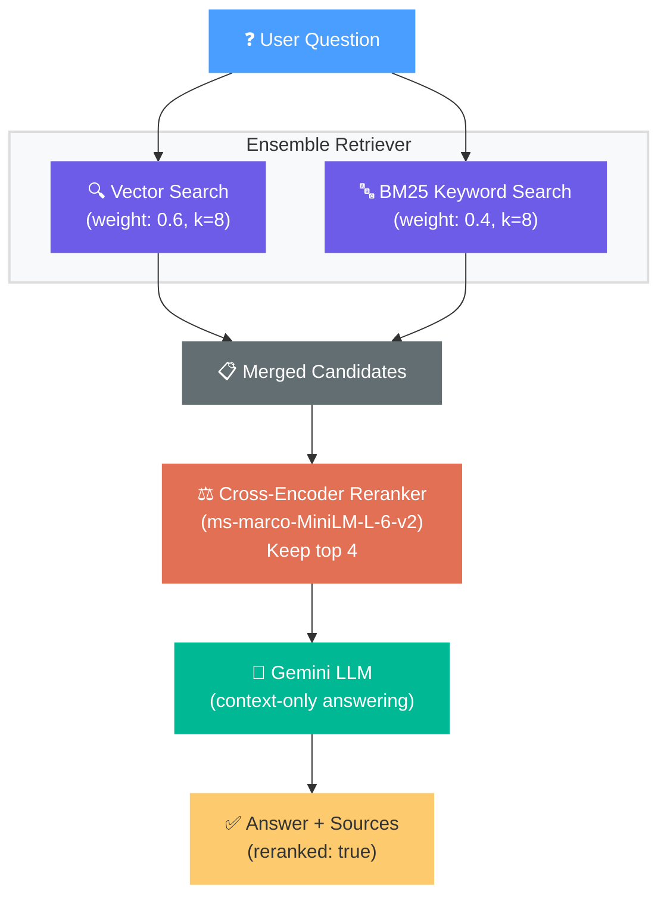

# 📄 RAG Document QA

A **Retrieval-Augmented Generation** API that lets you upload documents (PDF/TXT), automatically chunks and embeds them into a vector store, and then answers natural-language questions grounded strictly in the uploaded content. The system combines semantic search with keyword matching via a hybrid retriever, reranks candidates using a cross-encoder model, and generates answers with Google's Gemini LLM — ensuring responses are always traceable back to source documents and never hallucinated from outside knowledge.

---

## Architecture

The system runs two pipelines through a single FastAPI server:

### Ingestion Pipeline — `POST /ingest`



### Retrieval Pipeline — `POST /query`



---

## Local Setup

### Prerequisites

- Python 3.10+
- A [Google AI API key](https://aistudio.google.com/apikey)

### Installation

```bash
# Clone the repository
git clone  https://github.com/abhay-ugale-25/RagDocQA.git
cd rag_dev

# Create and activate a virtual environment
python -m venv venv
venv\Scripts\activate        # Windows
# source venv/bin/activate   # macOS / Linux

# Install dependencies
pip install -r requirements.txt

# Configure your API key
copy .env.example .env       # Windows
# cp .env.example .env       # macOS / Linux
# Then edit .env and paste your GOOGLE_API_KEY
```

### Run the Server

```bash
uvicorn app.main:app --reload --port 8000
```

The API will be available at `http://127.0.0.1:8000`. Interactive docs at `http://127.0.0.1:8000/docs`.

---

## API Reference

### `GET /health` — Health Check

```bash
curl http://127.0.0.1:8000/health
```

**Response** `200 OK`
```json
{
  "status": "ok"
}
```

---

### `POST /ingest` — Upload & Ingest a Document

```bash
curl -X POST http://127.0.0.1:8000/ingest \
  -F "file=@./data/my_paper.pdf"
```

**Response** `200 OK`
```json
{
  "status": "ingested",
  "file": "my_paper.pdf",
  "chunks": 66
}
```

| Parameter | Type       | Description                     |
|-----------|------------|---------------------------------|
| `file`    | `UploadFile` | PDF or TXT file to ingest     |

---

### `POST /query` — Ask a Question

```bash
curl -X POST http://127.0.0.1:8000/query \
  -H "Content-Type: application/json" \
  -d '{"question": "What is the main contribution of this paper?"}'
```

**Response** `200 OK`
```json
{
  "answer": "The main contribution of this paper is the introduction of the Transformer...",
  "sources": ["my_paper.pdf"],
  "reranked": true
}
```

| Field      | Type         | Description                                              |
|------------|--------------|----------------------------------------------------------|
| `answer`   | `string`     | LLM-generated answer grounded in the uploaded documents  |
| `sources`  | `list[str]`  | Source filenames the answer was derived from              |
| `reranked` | `bool\|null` | Whether cross-encoder reranking was applied              |

---

## Tech Stack

| Component             | Library                          | Why                                                                 |
|-----------------------|----------------------------------|---------------------------------------------------------------------|
| **Web Framework**     | FastAPI 0.111                    | Async-first, auto-generated OpenAPI docs, Pydantic validation       |
| **ASGI Server**       | Uvicorn 0.30                     | Lightning-fast ASGI server, hot-reload for development              |
| **LLM**              | Gemini 3.1 Flash Lite            | Fast, low-latency responses; generous free-tier quota               |
| **Embeddings**        | Gemini Embedding 001             | High-quality dense embeddings optimized for retrieval               |
| **Vector Store**      | ChromaDB 0.5                     | Simple, file-persisted vector DB — zero infrastructure overhead     |
| **Orchestration**     | LangChain 0.2                    | Composable chains for retrieval QA; handles prompt templating       |
| **PDF Parsing**       | PyPDF 4.2                        | Reliable text extraction from PDF documents                         |
| **Keyword Search**    | rank-bm25 0.2                    | Classic TF-IDF style retriever for exact keyword matching            |
| **Reranker**          | sentence-transformers 3.0 (CrossEncoder) | `ms-marco-MiniLM-L-6-v2` scores query-document relevance precisely |
| **Validation**        | Pydantic 2.7                     | Type-safe request/response models with auto-generated JSON schemas  |
| **Config**            | python-dotenv 1.0                | Loads API keys from `.env` — keeps secrets out of code              |

---

## How It Works

### The Problem

Imagine you have a 50-page research paper and you want to ask it questions like a conversation. You *could* paste the whole thing into ChatGPT — but what if it's too long? What if you have 100 documents? That's where RAG comes in.

### Step 1: Ingestion (Teaching the System Your Documents)

When you upload a PDF, the system doesn't just store it — it **reads and breaks it into small pieces** (called "chunks") of about 800 characters each, like cutting a book into index cards. Each card gets a small overlap with its neighbors so no idea gets split in half.

Then each chunk gets converted into a **list of numbers** (an "embedding") that captures its *meaning*. The sentence "The cat sat on the mat" and "A feline rested on the rug" would produce very similar number lists, even though they share almost no words. These embeddings are stored in a database (ChromaDB) for fast lookup later.

### Step 2: Retrieval (Finding the Right Index Cards)

When you ask a question, the system searches for relevant chunks using **two different strategies simultaneously**:

1. **Semantic search** (60% weight) — converts your question into the same kind of number list and finds chunks with similar *meaning*. Great for paraphrased concepts.

2. **Keyword search** (40% weight) — looks for chunks that share the same *exact words* as your question. Great for technical terms, names, or acronyms.

The results from both searches are merged together, giving you the best of both worlds.

### Step 3: Reranking (Picking the Best of the Best)

The merged list might have 10–15 candidate chunks, but not all are equally relevant. A specialized **reranker model** reads each chunk side-by-side with your question and assigns a relevance score. Only the **top 4 highest-scoring chunks** survive — this dramatically improves answer quality by filtering out noise.

### Step 4: Generation (Writing the Answer)

Those 4 carefully-selected chunks are inserted into a prompt template that tells the LLM: *"Answer this question using ONLY the following context. If the answer isn't there, say you don't know."* The LLM (Gemini) then writes a natural-language answer and cites which source documents it used.

The result: an answer that's **always grounded in your actual documents**, never made up.

---

## Project Structure

```
rag_dev/
├── app/
│   ├── __init__.py
│   ├── main.py          ← FastAPI app, routes, lifespan
│   ├── ingest.py        ← load → chunk → embed → store
│   ├── retriever.py     ← ensemble search → rerank → LLM chain
│   └── schemas.py       ← Pydantic request/response models
├── data/                ← uploaded documents land here
├── vectorstore/         ← ChromaDB persists embeddings here
├── .env.example
├── .gitignore
├── requirements.txt
└── README.md
```

